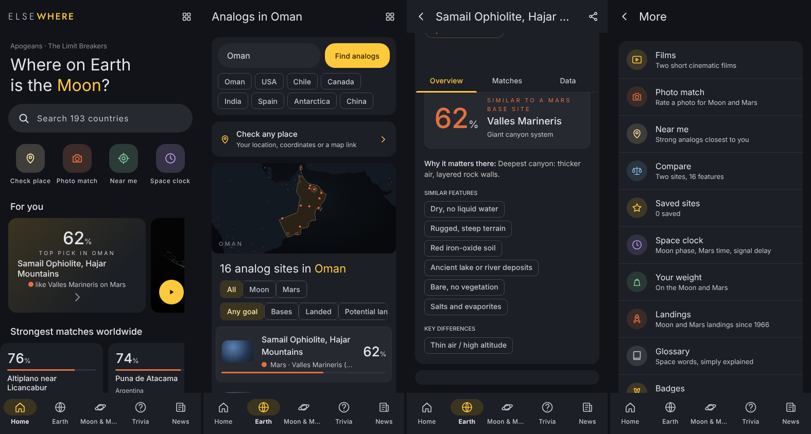
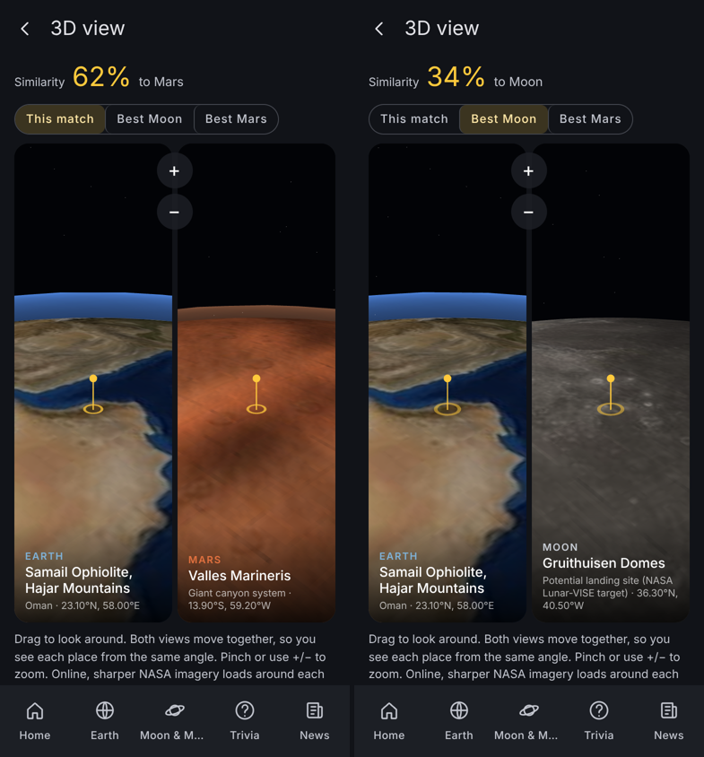

# Elsewhere

**Find the Moon and Mars on Earth.**

Elsewhere is a free Android app that finds the places on Earth that are most like real sites on the Moon and Mars. Pick any country and it shows you its best "analog sites", gives each one a score out of 100%, and explains why: what is similar, what is different, and the data behind it. It works offline.

Made by **Apogeans: The Limit Breakers** for the NASA Space Apps Challenge 2026 (lunar base challenge).

## ▶ Try the app

- **In your browser (no install):** https://ashwinhit.github.io/elsewhere/
  Works on a laptop or a phone. Tap **Present Elsewhere** on the home screen for a 90-second guided tour.
- **On Android:** download [`release/Elsewhere-v2.1.apk`](release/Elsewhere-v2.1.apk) and open it.
- **Offline:** download this repository and open `index.html` in any browser.





## 🤖 How AI helped

We want to be clear about this. **AI (Anthropic's Claude) helped us analyze the immense amount of data behind Elsewhere.** The app compares Earth, the Moon and Mars using elevation, climate, geology and surface data from many large public datasets. Going through all of that by hand was not possible in a hackathon, so we used AI to help us:

- analyze and process the raw Earth, Moon and Mars datasets,
- turn them into the 16 feature scores we give every place,
- build the similarity matching and the whole-surface scans of the Moon and Mars,
- write and debug parts of the app's code.

The same notice is written at the top of every code file, and right above the data inside `src/app/index.html`. The promotional films we made are AI-generated and labelled as such. The demo footage shows the real app.

## What the app does

- **Find analogs:** choose any of the 193 UN member states to see its analog sites on a map, ranked by similarity. Filter by Moon or Mars.
- **See why:** every site shows its best Moon and Mars matches, shared and different features, and the data behind it.
- **Check any place:** use your location, type coordinates or paste a map link.
- **Scan the Moon and Mars:** compare one Earth site against every 2.5° square of the Moon or Mars (10,368 squares each).
- **Photo match:** rate a photo, or the live camera, for how Moon-like or Mars-like it looks. Photos stay on the phone.
- **Learn:** trivia, a live space clock, a timeline of landings, a glossary and badges.
- **Present mode:** a guided tour of the app for live demos.

## How it works

Every place, whether on Earth, the Moon or Mars, gets 16 scores from 0 to 9: dryness, cold, temperature swings, rugged terrain, altitude, water ice, volcanic rock, impact geology, loose dust, red iron-oxide soil, caves and lava tubes, ancient lake deposits, polar light, bare ground, salts and dunes. Elsewhere compares these scores to rate how alike two places are, from 0 to 100%.

## Data

- **Earth:** NASA SRTM / GMTED2010 elevation, MODIS land surface temperature, NASA POWER, WorldClim, ESA WorldCover, Köppen–Geiger climate map, Macrostrat, Natural Earth, a volcano database and the Earth Impact Database
- **Moon:** LOLA, Diviner, LROC
- **Mars:** MOLA, THEMIS
- **Both:** SWIM, USGS geologic maps, NASA Moon Trek and Mars Trek imagery

## Install

Download [`release/Elsewhere-v2.1.apk`](release/Elsewhere-v2.1.apk) on an Android phone (Android 7 or newer) and open it. If Play Protect warns you, tap **More details → Install anyway**.

## Project layout

```
index.html            the complete app, ready to run (open it in a browser, or via GitHub Pages)
*.jpg, *.mp4          images and films the app shows
src/app/index.html    the core app source: map, matching and data
src/shell/            the phone app layer: pages, navigation, trivia, tools, photo match, present mode
src/shell/build_app.py  combines src/ into the single offline index.html
android/              the Android project (apktool format)
scripts/build_apk.sh  builds a signed APK
vendor/               fonts (SIL OFL) and libraries (d3, topojson) bundled for offline use
release/              ready-to-install APK
docs/                 screenshots
```

## Build it yourself

```bash
python3 src/shell/build_app.py                      # rebuilds index.html and android/assets/www/index.html
KEYSTORE=your.jks ./scripts/build_apk.sh            # full signed APK -> build/Elsewhere.apk
```

## Team

Apogeans: The Limit Breakers, Muscat, Oman
